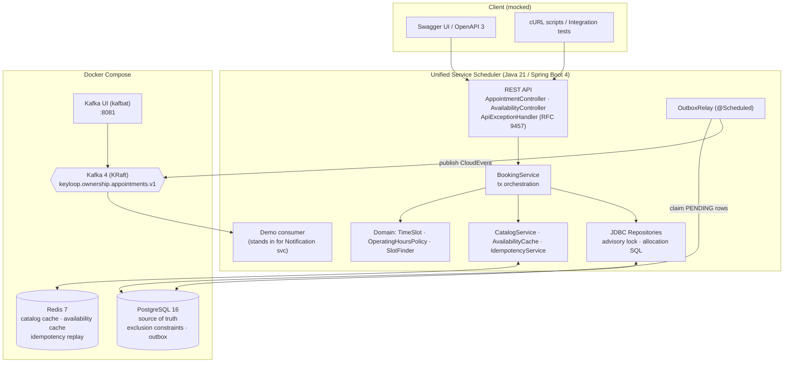
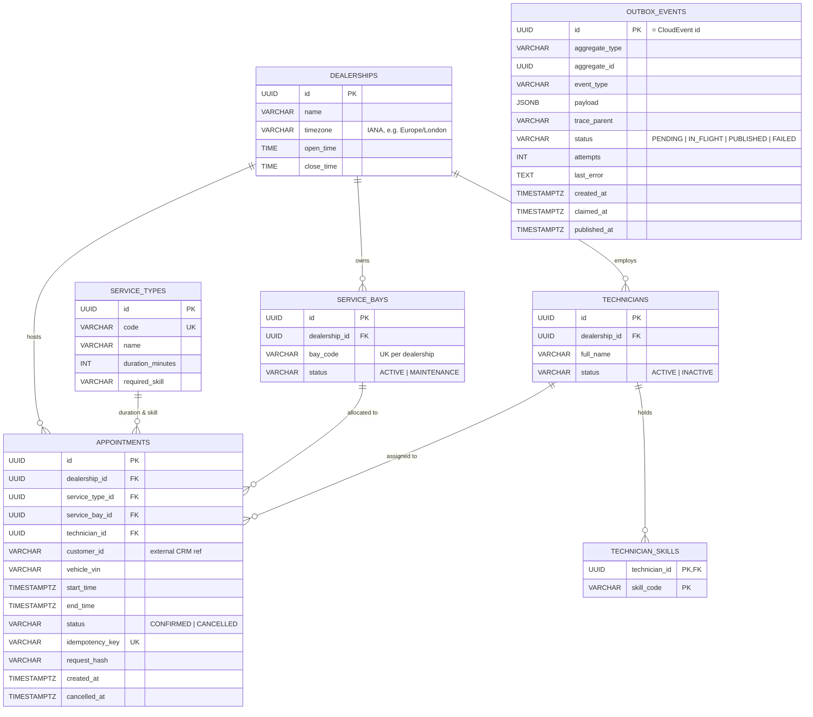
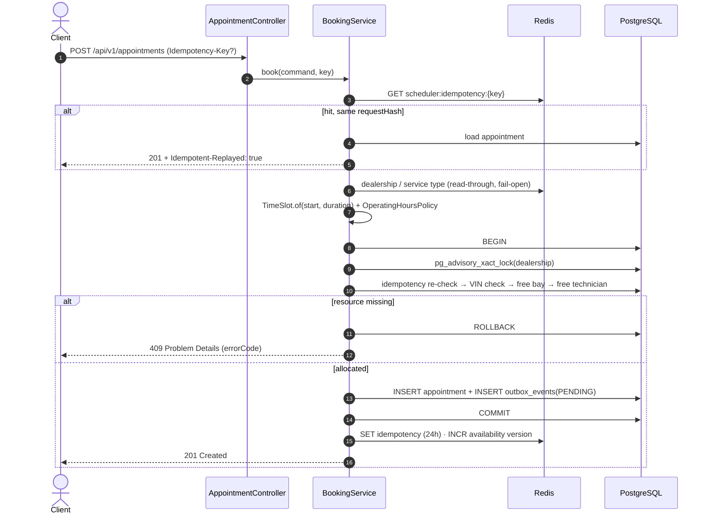
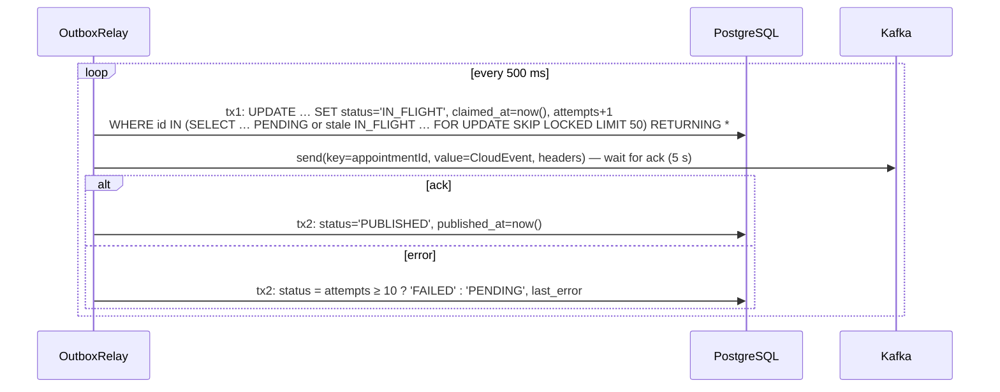

# System Design Document: The Unified Service Scheduler

- **Challenge Scenario:** Scenario A – The Unified Service Scheduler (*Domain: Ownership*)
- **Implemented Service Layer:** Backend (REST API, PostgreSQL, Redis, Kafka via Transactional Outbox)
- **Mocked Service Layer:** Client (OpenAPI 3 / Swagger UI, cURL scripts) — plus Kafka UI to inspect published events
- **Document Version:** 2.0 (v1.1 drafted with Gemini; v2.0 after cross-review — see §15)

---

## Table of Contents
1. [Executive Summary](#1-executive-summary)
2. [Scope: Implemented vs. Designed-only](#2-scope-implemented-vs-designed-only)
3. [Assumptions & Business Rules](#3-assumptions--business-rules)
4. [System Architecture](#4-system-architecture)
5. [Component Roles & Responsibilities](#5-component-roles--responsibilities)
6. [Data Architecture](#6-data-architecture)
7. [Concurrency & Correctness Strategy](#7-concurrency--correctness-strategy)
8. [Detailed Data Flows](#8-detailed-data-flows)
9. [API Contract](#9-api-contract)
10. [Technology Stack & Justifications](#10-technology-stack--justifications)
11. [Observability Strategy](#11-observability-strategy)
12. [Reliability & Failure Modes](#12-reliability--failure-modes)
13. [Scalability Path](#13-scalability-path)
14. [Testing Strategy](#14-testing-strategy)
15. [Generative AI Collaboration in the Design Phase](#15-generative-ai-collaboration-in-the-design-phase)

---

## 1. Executive Summary

The **Unified Service Scheduler** replaces manual workshop booking sheets with a backend service that lets a customer or service advisor book a maintenance appointment for a **vehicle (VIN)**, **service type** and **dealership** at a **desired start time**.

Before confirming, the service checks — for the *entire* service duration — that it can allocate both:

1. an `ACTIVE` **ServiceBay** at that dealership, and
2. an `ACTIVE` **Technician** at that dealership holding the skill the `ServiceType` requires.

On success it persists a `CONFIRMED` **Appointment** linking customer, vehicle, technician and bay, and publishes an `AppointmentConfirmed` event for downstream domains (notifications, parts, workshop board).

**Design principle:** *PostgreSQL is the single source of truth for correctness; Redis and Kafka are accelerators and integration channels.* If Redis is down, bookings still succeed (slower). If Kafka is down, bookings still succeed and events are delivered when it recovers.

---

## 2. Scope: Implemented vs. Designed-only

| Capability | Status |
| :--- | :--- |
| `POST /appointments` with automatic bay + qualified technician allocation | **Implemented** |
| Double-booking prevention (dealership advisory lock + GiST exclusion constraints) | **Implemented** |
| Operating-hours / past-time validation with dealership timezone (DST-safe) | **Implemented** |
| Idempotent create (`Idempotency-Key`, Postgres-backed, Redis replay cache) | **Implemented** |
| `GET /appointments/{id}`, `POST /appointments/{id}/cancel` | **Implemented** |
| `GET /dealerships/{id}/availability?date=&serviceTypeId=` (free start slots) + Redis cache | **Implemented** |
| Transactional Outbox → Kafka (`confirmed` / `cancelled` CloudEvents) | **Implemented** |
| Kafka UI (kafbat) to inspect topic, keys, headers, payloads and consumer lag | **Implemented** (Docker Compose) |
| Demo downstream consumer (logs received events, shows consumer group in Kafka UI) | **Implemented** |
| Metrics (Prometheus), JSON logs, OpenTelemetry tracing, optional Grafana LGTM stack | **Implemented** |
| AuthN/AuthZ (OAuth2 / dealer-scoped tokens) | Designed-only (§13) |
| Technician shifts, leave, dealership holidays, lunch breaks | Designed-only (assumption §3.6) |
| Rescheduling, partial-day closures, multi-bay jobs | Out of scope |
| Real Customer / Vehicle master data | Out of scope — owned by CRM domain (§3.5) |

---

## 3. Assumptions & Business Rules

1. **Service duration & skill.** Each `ServiceType` (e.g. `OIL_CHANGE`, `BRAKE_INSPECTION`, `EV_BATTERY_DIAGNOSTICS`) has a fixed `duration_minutes` and exactly one `required_skill`.
2. **Half-open intervals.** An appointment occupies `[start, start + duration)`. Back-to-back bookings (09:00–10:00 and 10:00–11:00) do **not** conflict. Two intervals overlap iff `startA < endB AND endA > startB`.
3. **Auto-allocation.** The client never picks a bay or technician. The service picks:
   - **Bay:** first free active bay ordered by `bay_code` (bays are assumed interchangeable).
   - **Technician:** among free, active, qualified technicians, the one with the **fewest skills** first (tie-break by name, id). This keeps scarce specialists (e.g. EV-certified) free for jobs only they can do.
4. **Time & operating hours.** All API timestamps are ISO-8601 UTC. Each dealership has an IANA timezone and daily `open_time`/`close_time` (local). The whole appointment must fit inside opening hours of the local day it starts on, evaluated in the dealership's zone (so DST shifts are handled). Start times in the past → `422`.
5. **Customer & vehicle ownership.** Customer and vehicle master data belong to the CRM / Ownership master domain. The scheduler stores `customer_id` (external reference) and a validated `vehicle_vin` (17 chars, ISO 3779 alphabet — no `I`, `O`, `Q`) on the appointment. This satisfies "associating customer and vehicle" without duplicating another domain's data.
6. **Working calendar.** Dealerships are open every day with the same hours; technicians are available whenever the dealership is open. Shifts/holidays are a designed extension (an `unavailability` table subtracted in the same queries).
7. **Vehicle rule.** One vehicle cannot have two overlapping `CONFIRMED` appointments — across any dealership.
8. **Cancellation.** Cancelling sets status `CANCELLED`, frees the bay/technician immediately (constraints only apply to `CONFIRMED` rows) and emits `AppointmentCancelled`.
9. **Availability is advisory.** The availability endpoint is a read model; the slot is only guaranteed when `POST /appointments` returns `201`.
10. **Idempotency.** `Idempotency-Key` is optional. Same key + same body → original appointment replayed (`201`, header `Idempotent-Replayed: true`). Same key + different body → `422`.

---

## 4. System Architecture

### 4.1. High-Level Architecture (Mermaid)



### 4.2. ASCII Fallback

```text
 Swagger UI / cURL ──HTTP JSON──▶ ┌──────────────── Spring Boot service ────────────────┐
                                  │ Controllers ─▶ BookingService ─▶ Domain policies    │
                                  │                   │      │                          │
                                  │     Redis caches ◀┘      └▶ JDBC repos ─────────────┼──▶ PostgreSQL 16
                                  │  (catalog/avail/idem)        (advisory lock,        │     appointments
                                  │                               exclusion constr.)    │     outbox_events
                                  │ OutboxRelay ◀── claim PENDING ──────────────────────┼──── (same DB)
                                  │      │                                              │
                                  └──────┼──────────────────────────────────────────────┘
                                         ▼
                                  Kafka (KRaft) ──▶ demo consumer
                                         ▲
                                  Kafka UI :8081 (browse messages, headers, lag)
```

---

## 5. Component Roles & Responsibilities

| Component | Responsibility |
| :--- | :--- |
| **AppointmentController / AvailabilityController** | HTTP contract, Bean Validation (VIN pattern, required fields), `Idempotency-Key` header, maps results to `201/200`. |
| **ApiExceptionHandler** | Maps `BookingRejectedException(reason)` and validation errors to RFC 9457 Problem Details with a stable `errorCode` and `traceId`. |
| **BookingService** | Orchestrates a booking: idempotency fast path → catalog lookup → policy validation → one DB transaction (lock, re-check idempotency, VIN check, allocate bay + technician, insert appointment + outbox row) → post-commit cache updates and metrics. Also cancellation. |
| **Domain (`TimeSlot`, `OperatingHoursPolicy`, `SlotFinder`)** | Pure, framework-free business rules: overlap predicate, timezone-aware opening-hours check, free-slot computation. Unit-tested without Spring. |
| **ResourceRepository / AppointmentRepository** | Explicit SQL via `JdbcClient`: `pg_advisory_xact_lock`, free-bay and free-technician queries, inserts, lookups. |
| **CatalogService** | Read-through Redis cache for dealership and service-type metadata (fail-open on Redis errors). |
| **AvailabilityService + AvailabilityCache** | Computes free start slots for a date; caches results in Redis keyed by a per-dealership-day *version* that is bumped on every booking/cancel. |
| **IdempotencyService** | Redis replay cache of `{requestHash, appointmentId}`; authoritative check is the `UNIQUE(idempotency_key)` column in Postgres. |
| **OutboxRelay** | Every 500 ms claims a batch of `PENDING` outbox rows in a short transaction, publishes them to Kafka **outside** any DB transaction, then marks them `PUBLISHED` (or schedules retry / `FAILED`). |
| **AppointmentEventsLoggingConsumer** | Demo downstream consumer (group `notification-service-demo`); proves end-to-end delivery and shows consumer lag in Kafka UI. |
| **Kafka UI (kafbat)** | Browser view of topic messages: timestamp, partition/offset, key, headers (`ce_type`, `traceparent`), JSON body. |

---

## 6. Data Architecture

### 6.1. Entity-Relationship Diagram



### 6.2. Integrity Constraints (defense in depth)

```sql
CREATE EXTENSION IF NOT EXISTS btree_gist;

-- inside CREATE TABLE appointments
CONSTRAINT excl_appointments_bay_overlap  EXCLUDE USING gist
    (service_bay_id WITH =, tstzrange(start_time, end_time, '[)') WITH &&) WHERE (status = 'CONFIRMED'),
CONSTRAINT excl_appointments_tech_overlap EXCLUDE USING gist
    (technician_id  WITH =, tstzrange(start_time, end_time, '[)') WITH &&) WHERE (status = 'CONFIRMED'),
CONSTRAINT excl_appointments_vin_overlap  EXCLUDE USING gist
    (vehicle_vin    WITH =, tstzrange(start_time, end_time, '[)') WITH &&) WHERE (status = 'CONFIRMED'),
CONSTRAINT uq_appointments_idempotency_key UNIQUE (idempotency_key)
```

Even if application logic had a bug, the database physically cannot store a double-booked bay, technician or vehicle.

### 6.3. Redis Key Design

Redis is an **accelerator only** — every Redis call is wrapped so that a Redis failure degrades to a DB read, never to an error.

| Key | Type | TTL | Purpose |
| :--- | :--- | :--- | :--- |
| `scheduler:cache:dealership:{id}` | STRING (JSON) | 1 h | Dealership timezone & hours |
| `scheduler:cache:servicetype:{id}` | STRING (JSON) | 1 h | Duration & required skill |
| `scheduler:availability:version:{dealershipId}:{date}` | STRING (counter) | 2 d | Bumped (`INCR`) on every booking/cancel touching that local date |
| `scheduler:cache:availability:{dealershipId}:{date}:{serviceTypeId}:v{version}` | STRING (JSON) | 60 s | Computed free slots; old versions simply expire — no `SCAN`/`DEL` storms |
| `scheduler:idempotency:{key}` | STRING (JSON) | 24 h | `{requestHash, appointmentId}` replay fast path |

### 6.4. Kafka Topic & Events

- **Topic:** `keyloop.ownership.appointments.v1` (3 partitions locally).
- **Key:** `appointmentId` — guarantees per-appointment ordering (`confirmed` before `cancelled`) and even partition spread. (v1.1 used `dealershipId`; rejected because a large dealership becomes a hot partition and consumers need per-appointment, not per-dealership, ordering.)
- **Headers:** `ce_type`, `ce_id`, `traceparent` (W3C, links async consumers to the original HTTP trace).
- **Delivery:** at-least-once. Consumers dedupe on CloudEvent `id` (= outbox row id).
- **Producer:** `acks=all`, `enable.idempotence=true`.

Event types: `com.keyloop.ownership.appointment.confirmed.v1`, `com.keyloop.ownership.appointment.cancelled.v1`.

```json
{
  "specversion": "1.0",
  "id": "0f1e0f7c-3a43-4c5e-9d0e-6c2b8f5b1a10",
  "source": "/keyloop/ownership/unified-service-scheduler",
  "type": "com.keyloop.ownership.appointment.confirmed.v1",
  "subject": "9b2d8f10-4c3a-41b2-8d9e-1a2b3c4d5e6f",
  "time": "2030-01-06T08:15:30Z",
  "datacontenttype": "application/json",
  "data": {
    "appointmentId": "9b2d8f10-4c3a-41b2-8d9e-1a2b3c4d5e6f",
    "dealershipId": "11111111-1111-1111-1111-111111111111",
    "dealershipName": "Keyloop Central Motors - London",
    "customerId": "CUST-90812",
    "vehicleVin": "WBA3A5C51CF256789",
    "serviceType": { "id": "44444444-4444-4444-4444-444444444403", "code": "EV_BATTERY_DIAGNOSTICS",
                     "name": "EV High-Voltage Battery Diagnostics", "durationMinutes": 120,
                     "requiredSkill": "EV_HIGH_VOLTAGE_CERT" },
    "allocatedServiceBay": { "id": "22222222-2222-2222-2222-222222222201", "bayCode": "BAY-01" },
    "assignedTechnician": { "id": "33333333-3333-3333-3333-333333333301", "fullName": "Alex Mercer" },
    "startTime": "2030-01-07T09:00:00Z",
    "endTime": "2030-01-07T11:00:00Z",
    "status": "CONFIRMED",
    "createdAt": "2030-01-06T08:15:30Z",
    "cancelledAt": null
  }
}
```

---

## 7. Concurrency & Correctness Strategy

### 7.1. Chosen approach

Inside a single `READ COMMITTED` transaction:

1. `SELECT pg_advisory_xact_lock(hashtextextended(:dealershipId, 0))` — serializes bookings **per dealership**. Released automatically on commit/rollback.
2. Re-check `Idempotency-Key` in the DB (now race-free for that dealership).
3. VIN overlap check → `409 VEHICLE_ALREADY_BOOKED`.
4. Select first free active bay → else `409 NO_SERVICE_BAY_AVAILABLE`.
5. Select best free qualified technician → else `409 NO_QUALIFIED_TECHNICIAN_AVAILABLE`.
6. Insert appointment + outbox row; commit.
7. Any `23P01` (exclusion violation) or `23505` (idempotency key) that still slips through — e.g. the same VIN booked concurrently at **two different dealerships** — is translated to the matching `409`/replay, never a `500`.

Because each statement in `READ COMMITTED` takes a fresh snapshot, every query after step 1 sees all appointments committed by previous lock holders.

### 7.2. Why not the v1.1 design (`FOR UPDATE SKIP LOCKED` on bays)

| Problem | Explanation |
| :--- | :--- |
| **False "no bay" (409) under load** | Row locks on `service_bays` are not tied to a time range. With 1 bay, a 14:00 booking holding the lock makes a concurrent 09:00 booking skip the bay and fail although 09:00 is free. |
| **Lock does not protect the predicate** | Availability is derived from `appointments`, not from the bay row. If transaction A commits and releases the bay lock while B's statement is running, B's `NOT EXISTS` sub-query may use a snapshot without A's insert, lock the bay and insert an overlap. Only the exclusion constraint would stop it — and v1.1 did not handle that error (→ HTTP 500). |
| **Extra moving part** | A Redisson VIN lock (5 s lease) duplicated what the VIN exclusion constraint already guarantees, and could expire mid-transaction. Removed. |

### 7.3. Alternatives considered

| Option | Verdict |
| :--- | :--- |
| `SERIALIZABLE` + retry on `40001` | Correct, but retries are noisy and hard to reason about under load. |
| Optimistic: insert, catch `23P01`, try next candidate | Correct, lock-free; more round-trips per booking and more complex code. Good future option if one dealership ever becomes hot. |
| **Advisory lock per dealership + constraints (chosen)** | Simple, correct, no false negatives. A workshop takes tens of bookings per hour, so per-dealership serialization costs nothing; different dealerships proceed fully in parallel. |

---

## 8. Detailed Data Flows

### 8.1. Create appointment



### 8.2. Outbox relay (no DB transaction held across network I/O)



`SKIP LOCKED` is correct *here*: it lets multiple relay instances claim disjoint batches. Rows stuck `IN_FLIGHT` for > 30 s (crashed instance) are reclaimed.

### 8.3. Availability read

`GET /dealerships/{id}/availability?date=2030-01-07&serviceTypeId=…` → read version counter → cache hit returns slots; miss loads active bays, qualified technicians and that day's confirmed appointments in 3 queries, runs `SlotFinder` (30-minute grid, inside opening hours, not in the past), caches for 60 s.

### 8.4. Cancel

`POST /appointments/{id}/cancel` → one transaction: `UPDATE … SET status='CANCELLED' WHERE id=? AND status='CONFIRMED'` + outbox `cancelled` event → bump availability version.

---

## 9. API Contract

Base path `/api/v1`. Full contract served at `/swagger-ui.html` and `/v3/api-docs`.

| Method & Path | Success | Purpose |
| :--- | :--- | :--- |
| `POST /appointments` | `201` + `Location` | Book (auto-allocate bay + technician) |
| `GET /appointments/{id}` | `200` | Read appointment |
| `POST /appointments/{id}/cancel` | `200` | Cancel, free resources |
| `GET /dealerships/{id}/availability?serviceTypeId=&date=` | `200` | Free start times for a local date |

**Request**

```json
{
  "dealershipId": "11111111-1111-1111-1111-111111111111",
  "customerId": "CUST-90812",
  "vehicleVin": "WBA3A5C51CF256789",
  "serviceTypeId": "44444444-4444-4444-4444-444444444403",
  "desiredStartTime": "2030-01-07T09:00:00Z"
}
```

**Response `201`** — same shape as the event `data` object in §6.4.

**Error model (RFC 9457 Problem Details)**

```json
{
  "type": "https://api.keyloop.example/errors/no-qualified-technician-available",
  "title": "No qualified technician available",
  "status": 409,
  "detail": "No active technician with skill EV_HIGH_VOLTAGE_CERT is free between 2030-01-07T09:00:00Z and 2030-01-07T11:00:00Z",
  "instance": "/api/v1/appointments",
  "errorCode": "NO_QUALIFIED_TECHNICIAN_AVAILABLE",
  "traceId": "65f8a9c1e2b34d56a7890c1d2e3f4a5b"
}
```

| `errorCode` | HTTP |
| :--- | :--- |
| `VALIDATION_FAILED` (missing field, bad VIN, bad UUID) | 400 |
| `DEALERSHIP_NOT_FOUND`, `SERVICE_TYPE_NOT_FOUND`, `APPOINTMENT_NOT_FOUND` | 404 |
| `NO_SERVICE_BAY_AVAILABLE`, `NO_QUALIFIED_TECHNICIAN_AVAILABLE`, `VEHICLE_ALREADY_BOOKED`, `APPOINTMENT_ALREADY_CANCELLED` | 409 |
| `START_TIME_IN_PAST`, `OUTSIDE_OPERATING_HOURS`, `IDEMPOTENCY_KEY_REUSED` | 422 |

---

## 10. Technology Stack & Justifications

| Layer | Technology | Justification |
| :--- | :--- | :--- |
| Language | **Java 21 (LTS)** | Records for immutable domain/DTOs, virtual threads for blocking JDBC/Redis I/O. |
| Framework | **Spring Boot 4.1** | Current generation (Initializr default); declarative transactions, Actuator, structured logging, OpenTelemetry starter. |
| Data access | **Spring `JdbcClient`** (no JPA) | The core logic *is* the SQL (advisory lock, overlap predicates). Explicit SQL is easier to review and verify than ORM-generated queries. |
| Database | **PostgreSQL 16 + Flyway** | `tstzrange`, `btree_gist` exclusion constraints, advisory locks, `SKIP LOCKED` for the outbox. Versioned migrations + seed data. |
| Cache | **Redis 7.4** (Spring Data Redis / Lettuce) | Catalog, availability and idempotency-replay caches with TTLs; fail-open. |
| Messaging | **Apache Kafka 4 (KRaft)** | Decouples booking from downstream domains; no ZooKeeper. |
| Event UI | **kafbat Kafka UI** | Shows when each message was published, its key, headers and JSON body; consumer group lag. |
| API docs / mock client | **springdoc-openapi 3** | Swagger UI acts as the mocked frontend. |
| Observability | **Micrometer + Prometheus, OpenTelemetry, ECS JSON logs**; optional **Grafana LGTM** | See §11. |
| Testing | **JUnit 5, AssertJ, Testcontainers (Postgres, Redis, Kafka), Awaitility** | Real infrastructure in tests — the concurrency guarantee is only meaningful against a real Postgres. |

---

## 11. Observability Strategy

**Logging** — ECS-format JSON to stdout (`logging.structured.format.console=ecs`). Trace/span ids are added automatically by Micrometer Tracing. Every booking decision logs `dealershipId`, `serviceTypeCode`, `outcome`, `bayCode`, `technicianId`.

**Metrics** (`/actuator/prometheus`)

| Metric | Type | Tags / meaning |
| :--- | :--- | :--- |
| `scheduler.bookings` | Counter | `outcome` = `CONFIRMED`, `REPLAYED`, or the `errorCode` |
| `scheduler.booking.duration` | Timer (p50/p95/p99) | End-to-end booking latency |
| `scheduler.outbox.pending` | Gauge | Unpublished outbox rows — alert if growing (Kafka down) |
| `scheduler.outbox.published` / `scheduler.outbox.failed` | Counter | Relay throughput / dead events |
| `scheduler.cache` | Counter | `cache`, `result=hit|miss|error` |

**Tracing** — OpenTelemetry via Micrometer. The booking request's W3C `traceparent` is stored in `outbox_events.trace_parent` and sent as a Kafka header, so a consumer's span can link back to the HTTP request that caused it. Export is off by default; `docker compose --profile observability up` starts Grafana LGTM (Tempo + Prometheus + Loki) on `:3000` and the app exports OTLP to it.

**Event visibility** — Kafka UI on `http://localhost:8081`: topic `keyloop.ownership.appointments.v1` → *Messages* shows publish timestamp, partition/offset, key, headers and payload; *Consumers* shows `notification-service-demo` lag.

**Health** — `/actuator/health` includes DB, Redis and Kafka indicators.

---

## 12. Reliability & Failure Modes

| Failure | Behaviour |
| :--- | :--- |
| Redis down | Caches bypassed (logged + `scheduler.cache{result=error}`); bookings still correct via Postgres. |
| Kafka down | Bookings still succeed; outbox rows stay `PENDING`; `scheduler.outbox.pending` rises; relay drains on recovery. |
| App crashes after commit, before publish | Row is still `PENDING` / stale `IN_FLIGHT` → re-published (at-least-once). |
| Event published, crash before marking `PUBLISHED` | Duplicate delivery; consumers dedupe on CloudEvent `id`. |
| Client times out and retries | Same `Idempotency-Key` → original appointment replayed, no duplicate. |
| Same VIN booked at two dealerships concurrently | VIN exclusion constraint → second gets `409 VEHICLE_ALREADY_BOOKED`. |
| Poison event (fails 10×) | Marked `FAILED`, counted in `scheduler.outbox.failed`, left for manual replay. |

---

## 13. Scalability Path

- **Stateless app** → horizontal scaling behind a load balancer; advisory locks live in Postgres so they work across instances.
- **Write contention** is bounded per dealership; dealerships are independent → natural **sharding key** (`dealership_id`) if a single Postgres ever becomes the bottleneck.
- **Read-heavy availability browsing** is absorbed by the Redis availability cache.
- **Outbox relay** scales out (claims use `SKIP LOCKED`); could be replaced by CDC (Debezium) without changing the event contract.
- **Security (next step):** OAuth2 resource server; dealership-scoped JWT claims enforced in the controller layer; rate limiting at the gateway.
- **Archival:** partition `appointments` by month on `start_time` once volume grows.

---

## 14. Testing Strategy

| Level | What | Examples |
| :--- | :--- | :--- |
| Unit (no Spring) | Pure domain rules | `TimeSlot` overlap incl. back-to-back & containment; `OperatingHoursPolicy` incl. DST (London summer time) and past times; `SlotFinder` grid & busy resources; `RequestFingerprint` stability |
| Integration (Testcontainers) | Real Postgres/Redis/Kafka | happy path allocation & fewest-skills technician choice; each `409`/`422`; cancel frees slot; idempotent replay and key reuse; availability excludes booked slots |
| Concurrency | The core guarantee | 20 threads book the same slot at a 1-bay dealership → exactly 1 × `201`, 19 × `409`, 1 row in DB |
| Messaging | Outbox → Kafka | booking produces a CloudEvent with `key = appointmentId`, `ce_type` header; outbox row becomes `PUBLISHED` |
| API | MockMvc over the full context | status codes, Problem Details shape, `Location` header, validation errors |

---

## 15. Generative AI Collaboration in the Design Phase

**Approach: AI drafts, a second AI cross-examines, I decide and verify.**

1. **Drafting (Gemini).** I gave Gemini the challenge brief and asked it to choose a scenario and produce a design. It chose Scenario A and produced v1.1: Postgres + Redis (Redisson VIN lock, idempotency) + Kafka outbox, with `FOR UPDATE SKIP LOCKED` for allocating bays and technicians.
2. **Adversarial review (second agent, Qoder).** Instead of accepting the polished draft, I had a different AI agent review it against the brief, explicitly asking it to look for correctness bugs, over-engineering and missing requirements. It reported:
   - `SKIP LOCKED` on bay rows causes **false 409s** under concurrency and does not protect the overlap predicate (snapshot race) — the exclusion-constraint error that would result was unhandled.
   - Redis-only idempotency loses the record if the process dies between commit and `SET`.
   - The outbox relay held a DB transaction open during the Kafka send — the very thing the doc claimed to avoid.
   - Missing: test strategy, explicit scope, customer/vehicle ownership assumption, technician allocation fairness, `GET`/cancel endpoints.
3. **My decisions (human ownership).**
   - Verified each claim against PostgreSQL semantics (READ COMMITTED snapshots per statement, row locks vs. predicate locks) before accepting it.
   - Chose *advisory lock per dealership + exclusion constraints* over `SERIALIZABLE` or optimistic retry, after weighing the alternatives in §7.3.
   - **Kept Redis and Kafka**, but re-scoped Redis to a pure accelerator (catalog, availability, idempotency replay) with Postgres as the authority, and added Kafka UI so event timing and payloads are observable during the demo.
   - Removed the Redisson lock; changed the Kafka key to `appointmentId`.
4. **Verification plan.** Every rule in §3 maps to an automated test (§14); the concurrency test against real Postgres is the acceptance gate for the AI-generated allocation code.
