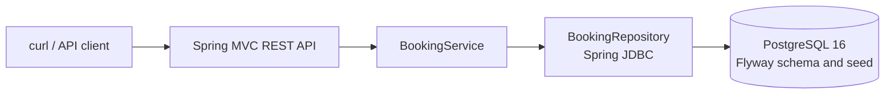
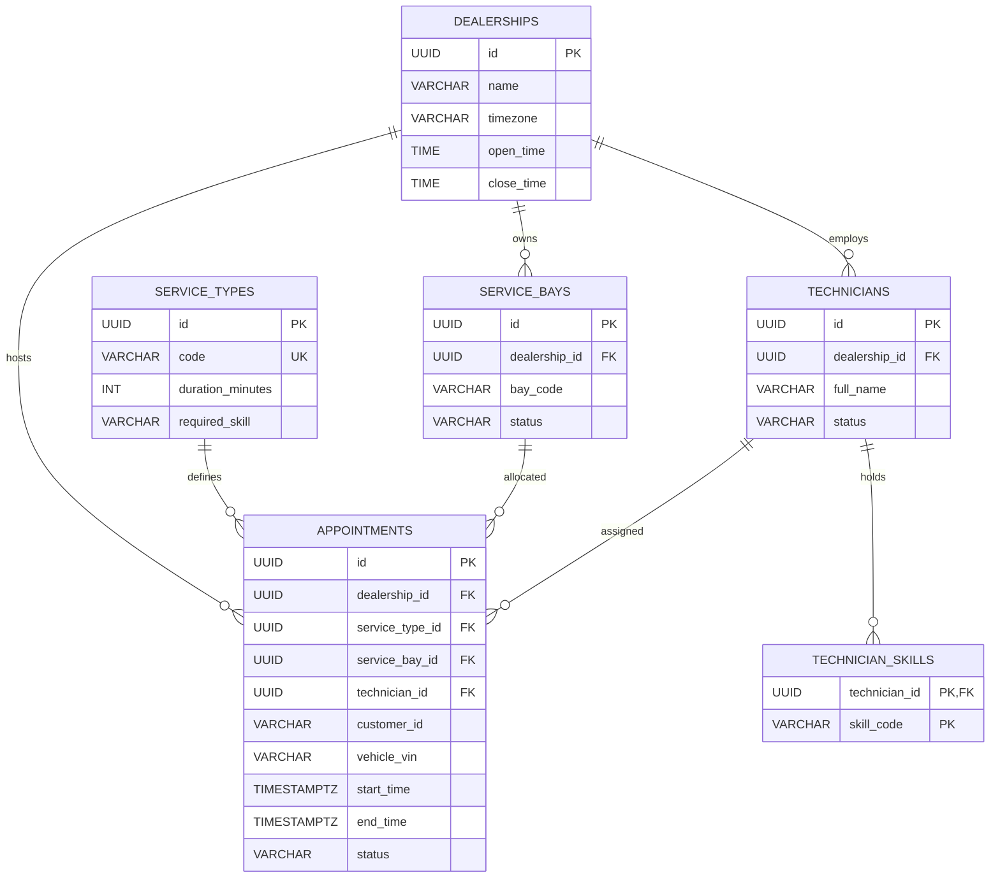

# Unified Service Scheduler — System Design

## Challenge and scope

This design addresses Keyloop Scenario A (Ownership). The implemented service layer is a Java backend with a REST API and PostgreSQL persistence. The client is represented by curl requests and the API response contract.

The MVP implements appointment creation and retrieval, automatic allocation of an active service bay and a qualified active technician, full-duration conflict checks, and persistent appointment records. It does not implement a frontend, authentication, cancellation, a separate availability search, Redis, Kafka, an outbox, or a monitoring stack.

## Assumptions and business rules

- Each service type has one fixed duration and one required technician skill.
- A request identifies a dealership, customer, 17-character VIN, service type, and desired start instant.
- All stored appointment times are UTC instants. The dealership timezone and daily opening/closing times are stored for future calendar rules; the MVP does not reject requests based on opening hours.
- Appointment intervals are half-open: `[start, end)`. Appointments that touch at an endpoint do not overlap.
- Only `ACTIVE` bays and `ACTIVE` technicians with the required skill can be allocated.
- A vehicle cannot have overlapping confirmed appointments, including across dealerships.
- The API reports current availability only when a booking request is made. A separate availability search is out of scope.

## Architecture

- **REST API:** Validates request fields and exposes create and read operations. It maps invalid input and booking rejections to RFC 9457 Problem Details.
- **BookingService:** Loads dealership and service metadata, validates VIN and start time, takes the transaction lock, checks vehicle overlap, selects resources, calculates the end time, and inserts one appointment in a transaction.
- **BookingRepository:** Uses parameterized SQL for catalog reads, advisory locking, resource selection, appointment writes, and retrieval.
- **PostgreSQL:** Owns the appointment record and integrity rules. Flyway creates the schema and a small local demo catalog.
- **Client harness:** README curl requests demonstrate successful booking, retrieval, and a conflict.

## Data model

PostgreSQL `btree_gist` exclusion constraints prevent overlapping confirmed appointments for the same VIN, service bay, or technician. Composite foreign keys make sure the selected bay and technician belong to the appointment's dealership.

## Booking data flow

1. `POST /api/v1/appointments` receives dealership, customer, VIN, service type, and desired start time.
2. The API validates required fields, UUIDs, ISO-8601 timestamp, and VIN format.
3. `BookingService` loads dealership and service type, derives the full interval from the service duration, and rejects a past start.
4. A PostgreSQL transaction takes a transaction-scoped advisory lock for the dealership. This serializes resource allocation for concurrent bookings at that dealership.
5. The service rejects an overlapping VIN, then selects the first free active bay by code and the free active qualified technician with the fewest skills (name and ID break ties).
6. It inserts the confirmed appointment and commits. GiST exclusion constraints remain a second integrity boundary, including for a VIN race involving different dealerships.
7. The API returns `201 Created` with the appointment and a `Location` header. Conflicts return `409`; invalid requests return `400`; a past start returns `422`.
8. `GET /api/v1/appointments/{id}` reads the persisted appointment and allocation details.

## Concurrency and failure behavior

- The dealership advisory lock is held until the booking transaction commits or rolls back. The allocation queries then see appointments committed by the previous lock holder.
- GiST exclusion constraints independently reject overlapping confirmed VIN, bay, or technician intervals.
- Exclusion violations are translated to stable conflict codes rather than leaking a database exception as HTTP 500.
- PostgreSQL is required for the service. If it is unavailable, the API cannot create or retrieve appointments; there is no in-memory fallback.
- The local Compose stack binds PostgreSQL and the application API to localhost.

## API contract

- `POST /api/v1/appointments`: create and allocate an appointment; `201 Created` on success.
- `GET /api/v1/appointments/{id}`: return an appointment; `404 Not Found` when absent.
- Validation errors return `400 Bad Request` with `errorCode: VALIDATION_FAILED`.
- Unknown dealership/service type or appointment returns `404 Not Found`.
- Overlapping vehicle appointment or no available bay/technician returns `409 Conflict`.
- A start time in the past returns `422 Unprocessable Entity`.

See README for request examples and the seeded local IDs.

## Technology choices

| Technology | Reason |
|---|---|
| Java 21 and Spring Boot 4.1.2 | Familiar typed backend stack with validation, MVC, transactions, and JDBC support. |
| Spring JDBC | Explicit SQL makes allocation and PostgreSQL locking behavior visible and reviewable. |
| PostgreSQL 16 | Persistent relational model, transactions, advisory locks, and exclusion constraints. |
| Flyway | Versioned schema and repeatable demo catalog. |
| Docker Compose | Reproducible local PostgreSQL and Java 21 application without requiring a host JDK 21. |
| JUnit 5 and Testcontainers | Exercise interval behavior, migrations, API behavior, PostgreSQL constraints, and concurrency against a real database. |

## Observability

The MVP uses Spring Boot console logs for startup and error diagnostics and a PostgreSQL Compose health check for local readiness. The demo logs should avoid full customer or VIN values. Metrics, trace export, dashboards, and request correlation are future additions if the service moves beyond the interview exercise.

## Test strategy

- Unit tests cover overlap, adjacency, containment, and invalid intervals.
- PostgreSQL integration tests cover migrations, seeded catalog, allocation order, half-open conflicts, and exclusion constraints.
- Booking service tests cover success, invalid VIN, past start, unknown references, VIN overlap, no bay, no qualified technician, and retrieval.
- MockMvc tests cover success, malformed input, validation, status mapping, and RFC 9457 `errorCode` responses.
- A concurrency test removes the exclusion constraints only in its isolated test database, then proves the dealership lock uses two available resource pairs under twelve simultaneous requests. Separate repository tests cover the constraints themselves.

## Future work

If the service grows, add dealership opening-hours/DST validation, shifts and holidays, an availability endpoint, cancellation, idempotency keys, authentication, Redis read caching, an outbox/Kafka integration, and richer metrics/tracing. These are deliberately outside the MVP deadline.

## Generative AI collaboration

Qoder supplied the initial implementation plan and system design. I compared those documents with the Keyloop PDF, narrowed the delivery to the required backend flow, and corrected the document status so proposed work was not described as already implemented. Codex assisted with scaffolding and implementation. I reviewed the generated changes and used test-first checks against PostgreSQL: the migration test first failed because the schema was absent, the interval and repository tests exposed missing behavior, the API tests failed while routes were absent, and the concurrency test detected twelve duplicate allocations when the lock was removed. The finished checks passed after the corresponding fixes. The README records the actual run commands and demo path.
